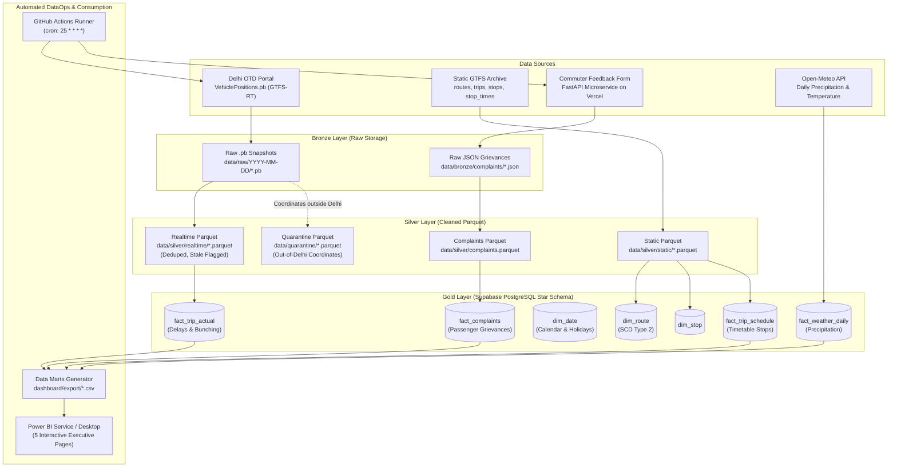

# TRACE: Transit Analytics & Reliability Correlation Engine
**An Automated DataOps, Reliability Analytics & Commuter Feedback Correlation System for Delhi Bus Transit**

[](https://www.python.org/)
[](https://supabase.com/)
[](https://github.com/unknownsteve7/trace41/actions)
[](https://trace-feedback.vercel.app)
[]()
[]()

---

## 1. Executive Summary & Problem Context

Delhi operates one of the world's largest urban surface transit networks through the **Delhi Transport Corporation (DTC)** and the **Delhi Integrated Multi-Modal Transit System (DIMTS)**, serving over **4.2 million commuters daily across 7,000+ buses**. Despite extensive route coverage, commuters face severe daily operational failures:

1. **The Bus Bunching & Delay Cascade Crisis**:
   Timetables promise buses every 10 minutes. In practice, initial congestion delays a lead bus ($B_1$), which accumulates larger boarding queues at each stop. Subsequent buses ($B_2, B_3$) encounter empty stops, catch up, and "bunch" into multi-bus platoons. Commuters endure 35-45 minute gaps followed by two or three empty buses arriving at once.
2. **The Disconnected Commuter**:
   When buses skip stops, when HVAC/air-conditioning fails during 45 deg C summer peaks, or when severe overcrowding occurs, passengers have no frictionless channel to report incidents. Traditional customer grievance portals require mobile app installations, user registration, and bureaucratic multi-day turnaround times.
3. **The "Blind Operator" Gap**:
   Transit management operates in administrative silos. Telemetry engineers track GPS coordinates on fleet maps, while customer support logs public complaints weeks later. Operators lack an automated mechanism to cross-reference passenger grievances with ground-truth vehicle telemetry to determine root causes.

**TRACE** addresses this systemic gap by establishing an automated, end-to-end data platform that pairs real-time vehicle telemetry with zero-barrier QR passenger feedback to calculate schedule adherence, isolate bus bunching corridors, and correlate service failures with citizen experience.

---

## 2. Comparative Analysis: Existing Systems vs. TRACE

| Feature / Dimension | Consumer Apps (Google Maps, One Delhi) | Fleet Management Systems (FMS) | Government Helplines (CPGRAMS, DTC Toll-Free) | TRACE Platform |
| :--- | :--- | :--- | :--- | :--- |
| **Primary Audience** | Commuters | Internal Depot Dispatchers | Bureaucratic Record Keepers | Transit Planners, Depot Managers, Commuters |
| **Data Standard** | Proprietary / Static GTFS | Proprietary Telematics | Unstructured Text Registers | Open GTFS & GTFS-RT (Protobuf) |
| **Bunching Analytics** | None | Raw GPS breadcrumbs | None | Algorithmic Headway Variance ($< 120$s) |
| **Feedback Channel** | Static reviews / Star ratings | None | Complex forms, login required | Instant QR scan (Zero-login, pre-filled metadata) |
| **Ground-Truth Correlation** | None | None | Post-mortem manual inspection | Automated spatial-temporal telemetry join |
| **DataOps Automation** | Closed vendor cloud | On-premise / Licensed VM | Manual batch reports | Hourly GitHub Actions CI/CD DAG |

---

## 3. The Four Fundamental Pillars

TRACE is architected around four core functional pillars:

```
+-----------------------------------------------------------------------------------+
|                            TRACE CORE ARCHITECTURE                                |
+-----------------------------------------------------------------------------------+
         |                                                 |
+--------v-------------------------+             +---------v------------------------+
|            PILLAR 1              |             |             PILLAR 2             |
|     Real-Time Operational        |             |       Algorithmic Headway        |
|          Reliability             |             |     & Bunching Detection         |
|  Continuous tracking of live     |             |  Sequential window lag analysis  |
|  positions vs static timetables  |             |  quantifying headway variance    |
|  to compute On-Time Perf. (OTP). |             |  and bunching (< 2.0 min).       |
+----------------┬-----------------+             +------------------┬---------------+
                 |                                                  |
                 +------------------------+-------------------------+
                                          |
+-----------------------------------------v-----------------------------------------+
|                                     PILLAR 4                                      |
|                            UNIFIED CORRELATION ENGINE                             |
|  Merges passenger grievance records with ground-truth vehicle telemetry to        |
|  diagnose operational root causes behind commuter dissatisfaction.                |
+-----------------------------------------^-----------------------------------------+
                                          |
                                  +-------+--------+
                                  |    PILLAR 3    |
                                  |  Zero-Barrier  |
                                  | QR Feedback    |
                                  |  10-second web |
                                  |  form, zero app|
                                  |  installation  |
                                  +----------------+
```

* **Pillar 1: Real-Time Operational Reliability**: Measures departure deviations against static timetable schedules to calculate On-Time Performance (OTP within $[-5, +5]$ minutes).
* **Pillar 2: Algorithmic Headway Variance & Bunching Detection**: Uses SQL `LAG()` window functions over chronological departures to calculate gap minutes and classify bunching events (headway $< 2.0$ minutes).
* **Pillar 3: Zero-Barrier Commuter Grievance Loop**: Physical QR stickers placed in bus cabins pass `vehicle_id` and `route_id` as URL parameters to a lightweight HTML form on Vercel, allowing riders to submit verified complaints in seconds.
* **Pillar 4: Unified Ground-Truth Correlation Engine**: Evaluates citizen feedback against actual bus movements at that exact timestamp and corridor, confirming operational failures.

---

## 4. End-to-End System Architecture

TRACE implements a **Medallion Architecture (Bronze -> Silver -> Gold)**, orchestrated entirely through automated CI/CD workflows and serverless microservices:



---

## 5. Gold Layer Star Schema Design

The relational data warehouse is modeled in **PostgreSQL (Supabase Cloud)** using a dimensional Star Schema:

```
                    +--------------------+
                    |      dim_date      |
                    +--------------------+
                    | PK  date_id        |
                    |     full_date      |
                    |     is_weekend     |
                    |     is_holiday     |
                    +---------+----------+
                              |
       +----------------------+----------------------+
       |                      |                      |
+------v---------------+ +----v----------------+ +----v---------------+
|  fact_trip_schedule  | |   fact_trip_actual   | |  fact_complaints   |
+----------------------+ +----------------------+ +----------------------+
| PK  id               | | PK  id               | | PK  id               |
| FK  date_id          | | FK  date_id          | | FK  date_id          |
| FK  route_key        | | FK  route_key        | | FK  route_key        |
| FK  stop_key         | |     scheduled_dep    | |     complaint_time   |
|     stop_sequence    | |     actual_dep       | |     complaint_type   |
|     arrival_time     | |     delay_minutes    | |     severity         |
|     departure_time   | |     is_on_time       | |     description      |
+------+---------------+ |     headway_min      | |     sentiment_score  |
       |                 |     is_bunched       | +----------^-----------+
       |                 |     ping_count       |            |
       |                 +----------+-----------+            |
       |                            |                        |
+------v----------+                 +------------+-----------+
|    dim_stop     |                              |
+-----------------+                    +---------v----------+
| PK  stop_key    |                    |     dim_route      |
|     stop_id     |                    +--------------------+
|     stop_name   |                    | PK  route_key      |
|     lat, lon    |                    |     route_id       |
+-----------------+                    |     route_short_name
                                       |     is_current     |
                                       +--------------------+
```

### Table Definitions & Grain

1. **`dim_date`**: Calendar spine covering operating dates with flags for Indian gazetted holidays and weekends.
2. **`dim_route`**: Slowly Changing Dimension (SCD Type 2) tracking transit routes, base numbers, and directionality (`UP`/`DOWN`).
3. **`dim_stop`**: Master repository of 6,800+ Delhi transit stops with WGS84 geographic coordinates.
4. **`fact_trip_actual`**: Granular record of every observed vehicle trip containing scheduled vs actual departure times, delay duration, headway gap, and bunching flag.
5. **`fact_trip_schedule`**: Scheduled timetable trips across all designated route stops.
6. **`fact_complaints`**: Commuter grievances mapped to route, date, rating, severity, sentiment score, and feedback category.
7. **`fact_weather_daily`**: Meteorological features including daily precipitation (mm), maximum temperature, and wind speed.

---

## 6. Automated DataOps Workflow (GitHub Actions)

TRACE operates autonomously using a scheduled **GitHub Actions DataOps Pipeline** ([`.github/workflows/trace_dataops.yml`](.github/workflows/trace_dataops.yml)).

```
┌─────────────────────────────────────────────────────────────────────────────┐
│                       AUTOMATED DATAOPS DAG EXECUTION                       │
└─────────────────────────────────────────────────────────────────────────────┘
                                       │
                Trigger: cron: '25 * * * *' (Hourly)
                     or manual workflow_dispatch
                                       │
        +------------------------------+------------------------------+
        |                                                             |
+-------v-----------------------------+     +-------------------------v-------------------+
|  STAGE 1: Ingest QR Grievances      |     |  STAGE 2: Ingest GTFS-RT Telemetry          |
|  - Calls Vercel Feedback REST API   |     |  - Polls Delhi OTD VehiclePositions.pb      |
|  - Applies incremental watermark    |     |  - Decodes Protobuf into Silver Parquet     |
|  - Regex route resolution           |     |  - Derives delays & bunching (< 2.0 min)    |
|  - Inserts into fact_complaints     |     |  - Loads into fact_trip_actual              |
+-------+-----------------------------+     +-------------------------+-------------------+
        |                                                             |
        +------------------------------+------------------------------+
                                       │
+--------------------------------------v--------------------------------------+
|  STAGE 3: Export Data Marts & Git Auto-Commit                               |
|  - Queries Supabase Gold Schema                                             |
|  - Exports updated CSV data marts in dashboard/export/                      |
|  - Commits updated files with chore(dataops) [skip ci]                      |
|  - Pushes commit to main branch for Power BI synchronization                |
+-----------------------------------------------------------------------------+
```

* **Incremental Watermark**: A persistent `watermark.txt` tracks the last ingested complaint timestamp, preventing duplicate ingestion.
* **Resilient Retry**: Real-time polling implements exponential backoff across 5 retries to handle upstream OTD portal network spikes.
* **Zero Infrastructure Cost**: Completely orchestrated on free-tier GitHub Actions and serverless cloud databases.

---

## 7. Advanced SQL Analytics Portfolio

The platform leverages advanced PostgreSQL features to calculate operational KPIs across large datasets:

* **Headway Dynamics & Bunching Detection** ([`sql/03_headway_bunching.sql`](sql/03_headway_bunching.sql)):
  ```sql
  LAG(fa.actual_departure) OVER (
      PARTITION BY fa.route_key, fa.date_id
      ORDER BY fa.actual_departure
  ) AS prev_departure
  ```
  Calculates the exact elapsed minutes between consecutive buses on the same corridor.
* **Delay Cascade Propagation** ([`sql/04_delay_cascade.sql`](sql/04_delay_cascade.sql)):
  Utilizes `WITH RECURSIVE` to trace how a minor 3-minute delay at stop 1 expands into a 25-minute delay by stop 20 due to compounding passenger queues.
* **Ghost Trip Detection** ([`sql/05_ghost_trips.sql`](sql/05_ghost_trips.sql)):
  Implements NULL-safe `NOT EXISTS` anti-joins between `fact_trip_schedule` and `fact_trip_actual` to isolate scheduled timetable runs that never physically operated.
* **Rolling Reliability Tracking** ([`sql/06_rolling_otp.sql`](sql/06_rolling_otp.sql)):
  Uses window frame specifications (`ROWS BETWEEN 2 PRECEDING AND CURRENT ROW`) to smooth out isolated spikes and track continuous 3-trip rolling On-Time Performance.

---

## 8. Power BI Executive Dashboard Architecture

The business intelligence layer reads pre-aggregated data marts published automatically to `dashboard/export/`:

| Page | Dashboard View | Target Metric | Primary Stakeholder |
| :---: | :--- | :--- | :--- |
| **Page 1** | **Executive Fleet Reliability** | Network OTP %, Average Fleet Delay, Total Trips Operated | DTC / DIMTS Board of Directors |
| **Page 2** | **Hourly Congestion & Temporal Trends** | Peak Hour (AM/PM) Delay Spikes, Hourly Trip Drop-off | Transit Schedulers & Schedulers |
| **Page 3** | **Bunching Hotspots & Headway Variance** | Headway Dispersion, Platooned Route Ranking, Bottlenecks | Central Traffic Dispatchers |
| **Page 4** | **Geographic Corridor Map** | Spatial Transit Network, Stop Coordinates (`lat`, `lon`), Radial Transit Hubs (Azadpur, Kashmere Gate, Anand Vihar) | Route Network & Infrastructure Planners |
| **Page 5** | **Commuter Grievances & Operational ML** | Grievance Category Breakdown (AC/HVAC Failure, Late Arrival), Severity Distribution, Feature Importance & Delay Forecasts | Depot Managers, Quality Officers & Analytics Teams |

---

## 9. Repository Structure

```text
trace41/
├── .github/
│   └── workflows/
│       └── trace_dataops.yml         # Automated GitHub Actions DataOps pipeline
├── collector/
│   ├── download_static_gtfs.py       # Static GTFS zip collector
│   ├── inspect_static_gtfs.py        # Static feed validator
│   ├── poll_gtfs_rt.py               # Live OTD GTFS-RT protobuf polling daemon
│   └── two_poll_test.py              # Telemetry difference verification
├── etl/
│   ├── static_to_silver.py           # Schedule ETL -> Silver Parquet
│   ├── realtime_to_silver.py         # Telemetry ETL -> Silver Parquet
│   ├── load_dimensions.py            # Supabase Dimension tables loader
│   ├── load_facts.py                 # Fact tables loader (OTP, delays, bunching)
│   └── ingest_feedback_api.py        # Vercel Feedback API -> Gold fact_complaints
├── sql/
│   ├── 01_create_schema.sql          # PostgreSQL DDL for Star Schema
│   ├── 02_otp_by_route.sql           # Route-level on-time performance queries
│   ├── 03_headway_bunching.sql       # LAG() headway & bunching detection
│   ├── 04_delay_cascade.sql          # Recursive CTE delay propagation
│   ├── 05_ghost_trips.sql            # NOT EXISTS anti-join ghost trip detection
│   ├── 06_rolling_otp.sql            # Moving-window rolling OTP analysis
│   ├── 07_views_matview.sql          # Materialized views for fast dashboards
│   ├── 08_stored_proc.sql            # Automated SQL loading stored procedures
│   └── 09_indexes.sql                # B-tree and partial index tuning
├── dashboard/
│   ├── export_for_powerbi.py         # Data mart extractor (CSVs & heartbeat)
│   ├── trace_dashboard.pbix          # Completed Power BI Desktop dashboard
│   └── export/                       # Exported CSVs synced to GitHub
├── qr/
│   ├── feedback_form.html            # Frictionless commuter complaint web UI
│   ├── generate_qr_samples.py        # QR code image generator
│   └── sample_qr_bus_interior.png    # Commuter interior test QR code
├── notebooks/
│   ├── stats_analysis.py             # Spearman correlation & statistical testing
│   ├── delay_prediction.py          # Proof-of-concept ML Random Forest model
│   └── simulate_complaints.py        # Synthetic test grievance generator
├── docs/                             # Academic UML diagrams (.puml, .mmd) & guides
├── requirements.txt                  # Python dependencies
└── README.md                         # Project documentation
```

---

## 10. Installation & Local Execution

### Prerequisites
* Python 3.11+
* PostgreSQL 16+ or Supabase Cloud instance
* Git

### Step 1: Clone & Install Dependencies
```bash
git clone https://github.com/unknownsteve7/trace41.git
cd trace41
pip install -r requirements.txt
```

### Step 2: Configure Environment Variables
Create a `.env` file in the project root:
```ini
PG_HOST=aws-0-ap-northeast-1.pooler.supabase.com
PG_PORT=5432
PG_DATABASE=postgres
PG_USER=your_postgres_user
PG_PASSWORD=your_postgres_password
PG_SSLMODE=require

OTD_API_KEY=your_delhi_otd_api_key
OTD_VEHICLE_POSITIONS_URL=https://otd.delhi.gov.in/api/realtime/VehiclePositions.pb
FEEDBACK_API_URL=https://trace-feedback.vercel.app
FEEDBACK_ADMIN_KEY=your_admin_secret_key
```

### Step 3: Run Data Pipeline Locally
```bash
# 1. Download and parse static timetable feed
python collector/download_static_gtfs.py
python etl/static_to_silver.py

# 2. Ingest static dimensions into database
python etl/load_dimensions.py

# 3. Poll real-time bus telemetry and process
python collector/poll_gtfs_rt.py --count 1 --force
python etl/realtime_to_silver.py
python etl/load_facts.py actual

# 4. Ingest QR grievances from Vercel microservice
python etl/ingest_feedback_api.py

# 5. Export fresh Data Marts for Power BI
python dashboard/export_for_powerbi.py
```

---

## 11. Future Scope & Operational Roadmap

1. **Automated Dispatch Interventions (Dynamic Headway Holding)**:
   Integrate real-time alerts into depot dispatcher consoles to hold trailing bunched buses at major stops for 2-3 minutes, re-establishing target headway intervals.
2. **Natural Language Processing (NLP) for Grievance Clustering**:
   Apply topic modeling (BERTopic / LDA) and sentiment analysis to passenger comment text to automatically cluster recurring maintenance complaints without manual tagging.
3. **Multi-Channel Push Notifications**:
   Connect pipeline alerts to Telegram and WhatsApp bot endpoints to notify route managers when bunching exceeds 20% on arterial corridors.
4. **Power BI Row-Level Security (RLS)**:
   Configure depot-wise access roles allowing individual depot managers to inspect only their assigned fleet while executive directors view city-wide metrics.

---

## 12. Authors & Academic Acknowledgments

* **Project**: TRACE (Transit Analytics & Reliability Correlation Engine)
* **Institution**: Rajiv Gandhi University of Knowledge Technologies (RGUKT) - Ongole Campus
* **Department**: Computer Science & Engineering
* **Guide**: Mr. Beerala Murali, Assistant Professor, Department of CSE
* **Team**: S. Nagamallikarjuna, V. Jagadeesh, P. Ajay, B. Vamsi Krishna
