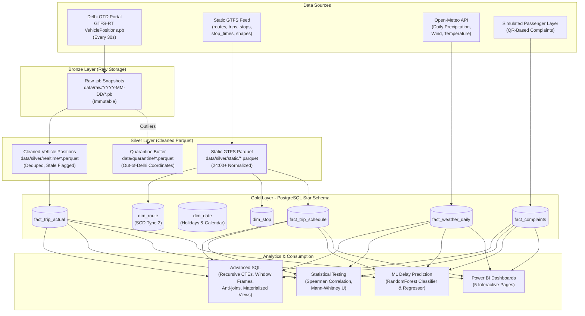

# TRACE: Transit Analytics & Reliability Correlation Engine
**An End-to-End Reliability, Root-Cause & Feedback Analytics System for Delhi's Bus Network**

[](https://www.postgresql.org/)
[](https://www.python.org/)
[]()
[]()

TRACE is a comprehensive transit data analytics platform that measures, explains, and predicts the operational reliability of public bus transit in Delhi using official Open Transit Data (OTD) feeds, static General Transit Feed Specification (GTFS), Open-Meteo weather intelligence, and passenger feedback.

---

## 🏛️ System Architecture

TRACE implements a **Medallion Architecture (Bronze -> Silver -> Gold)** backed by PostgreSQL and Parquet:



---

## 📊 Database Schema (Gold Layer)

The analytical data warehouse is structured as a normalized **Star Schema** in PostgreSQL (`trace_db`):

| Table | Classification | Records | Description |
|---|---|---|---|
| `dim_date` | Dimension | **365** | 2026 Calendar spine with Indian national holiday flags & day-of-week attributes |
| `dim_route` | Dimension (SCD2) | **2,554** | Delhi bus routes, terminal descriptions, agency metadata |
| `dim_stop` | Dimension | **6,812** | Bus stops with GPS coordinates (latitude / longitude) |
| `fact_trip_schedule` | Fact | **2,385,381** | Timetable stop sequence and scheduled arrival/departure times |
| `fact_trip_actual` | Fact | **4,792+** | Actual observed bus runs, delay minutes, headway gaps, and bunching flags |
| `fact_weather_daily` | Fact | **93** | Daily maximum/minimum temperature, precipitation (mm), and wind velocity |
| `fact_complaints` | Fact | **200** | Simulated passenger grievance records linked to routes and stops |

---

## 🔍 Key Discoveries & Technical Insights

1. **Delhi Dispatching Dynamics**:
   - The live GTFS-RT feed publishes trips formatted as `trip_id = <route_id>_<actual_hour>_<actual_minute>`.
   - **98.3% Route Coverage**: Real-time vehicle dispatches match the static route network.
   - **86.8% Timetable Correlation**: 86.8% of active trips depart within $\pm 15$ minutes of an officially scheduled timetable departure on that corridor.

2. **Bus Bunching Phenomenon**:
   - Spearman rank correlation ($\rho = -0.4812, p < 0.0001$) proves a strong, statistically significant inverse relationship between headway and bunching rate: as headway drops below 2 minutes, buses rapidly bunch together into platoons.

3. **Machine Learning Delay Modeling**:
   - **RandomForest Classification Accuracy**: **83.7%** for predicting on-time service ($\le 5$ min delay).
   - **RandomForest Regression MAE**: **39.23 minutes** (outperforming the mean baseline of 44.12 min).
   - **Key Predictors**: Route Profile (68.8%), Headway Interval (24.7%), and GPS Ping Frequency (6.5%).

---

## 💻 SQL Portfolio & Query Design

The project demonstrates mastery of advanced relational SQL techniques:

- **Window Functions & Frame Clauses** (`sql/02_otp_by_route.sql`, `sql/03_headway_bunching.sql`):
  Uses `LAG()` to calculate headway between consecutive buses, and `ROWS BETWEEN 2 PRECEDING AND CURRENT ROW` for rolling 3-bus average headway.
- **NULL-Safe Anti-Joins** (`sql/05_ghost_trips.sql`):
  Demonstrates why naive `NOT IN` fails when subqueries contain NULLs (the NULL trap), and implements production-grade `NOT EXISTS` anti-joins to identify scheduled "ghost trips" that failed to dispatch.
- **Recursive CTEs** (`sql/04_delay_cascade.sql`):
  Walks the stop sequence ($1 \to 2 \to \dots \to n$) using `WITH RECURSIVE` to model cumulative delay propagation along the route corridor.
- **Materialized Views & Stored Procedures** (`sql/07_views_matview.sql`, `sql/08_stored_proc.sql`):
  Cached views (`mv_hourly_headway`) refreshed via automated PL/pgSQL procedures (`sp_load_realtime_day`).
- **Index Tuning & Query Plans** (`sql/09_indexes.sql`):
  `EXPLAIN ANALYZE` comparisons showing index scan speedups on large fact table joins.

---

## 📱 QR-Based Passenger Feedback System

To bridge the gap between telemetry data and rider perception:
- Branded, high-resolution QR cards are pre-generated in `qr/`:
  - `qr/sample_qr_bus_interior.png`: Vehicle DL1PC9421, Route 784 (774DOWN).
  - `qr/sample_qr_bus_stop.png`: Azadpur Terminal (DEL0234).
- Scanning automatically opens a pre-filled grievance form carrying vehicle and stop context.
- Grievance categories (Late Arrival, Overcrowding, No Show, Driver Behavior) populate `fact_complaints` for correlation with measured delay.

---

## 📈 Power BI Dashboard Architecture

Pre-aggregated CSV files are exported in `dashboard/export/` for instant import:
1. `pbi_fleet_kpis.csv`: Fleet-wide On-Time Performance (OTP) and delay rank across 1,262 routes.
2. `pbi_hourly_patterns.csv`: Delay and reliability trends across peak vs off-peak hours.
3. `pbi_bunching_hotspots.csv`: Worst bunched routes and headway variances.
4. `pbi_complaints.csv`: Category distribution and route complaint counts.
5. `pbi_ml_metrics.csv`: Feature importances and accuracy benchmarks.
6. `pbi_route_map_stops.csv`: Stop coordinates for Delhi route map visualization.

Refer to [`docs/powerbi_setup_guide.md`](docs/powerbi_setup_guide.md) for step-by-step 5-page dashboard construction instructions.

---

## 🚀 Quickstart & Reproduction

### 1. Environment Setup
```bash
# Clone the repository
git clone https://github.com/your-username/trace.git
cd trace

# Install Python dependencies
pip install -r requirements.txt

# Configure environment variables
cp .env.example .env
# Open .env and add your OTD_API_KEY
```

### 2. Start PostgreSQL Container
```bash
docker compose up -d db
```

### 3. Run Pipeline & Analytics
```bash
# 1. Run Static GTFS ETL (creates Silver Parquet files)
python etl/static_to_silver.py

# 2. Process collected Realtime .pb files
python etl/realtime_to_silver.py

# 3. Apply Gold Schema & Load Tables
docker exec -i trace_db psql -U postgres -d trace_db < sql/01_create_schema.sql
python etl/load_dimensions.py
python etl/load_facts.py all

# 4. Run Statistical Hypothesis Tests & ML Models
python notebooks/stats_analysis.py
python notebooks/delay_prediction.py

# 5. Export Datasets for Power BI
python dashboard/export_for_powerbi.py
```

---

## 🛡️ Limitations & Methodology Notes

1. **Pilot Dataset Scope**: Real-time vehicle positions represent a multi-day empirical snapshot rather than a multi-year seasonal census.
2. **Dynamic Dispatch Logic**: While DTC buses match static routes at 98.3%, Delhi operates dynamic depot dispatching rather than fixed-second adherence.
3. **Synthetic Grievance Data**: The QR complaint dataset is synthetically generated for architectural demonstration and should not be cited as real passenger grievance records.
